# HCMAN Training Runbook — Mayo Clinic Platform

Last updated: Oct 13, 2026

This runbook takes HCMAN from an empty Mayo Clinic Platform workbench to a trained, reviewed model the CardioAI app can call. It is the first training of the model: every encoder is pre-trained from scratch inside the platform, and ECG and echo imaging are required. All commands run from the `ml/` folder of branch `hcman-mcp-training`.

## At a glance

```mermaid
flowchart LR
    S1["1 · Setup<br/>13 tests pass"] --> S2["2 · Configure<br/>5 ECG + 5 echo load"]
    S2 --> S3["3 · Feasibility<br/>Gate 1: enough cases"]
    S3 --> S4["4 · Study tables<br/>Gates 2, 3: imaging, sites"]
    S4 --> S5["5 · Pre-train<br/>4 stages, no labels"]
    S5 --> S6["6 · Fine-tune<br/>ablation, then full"]
    S6 --> S7["7 · Evaluate<br/>accept or iterate"]
    S7 -- "iterate: new run folder" --> S6
    S7 -- accepted --> S8["8 · Export + app<br/>staging, then live"]
    classDef gate fill:#e3eefc,stroke:#2f6fdb,stroke-width:2px;
    class S3,S4,S7 gate;
```



Highlighted steps end in a go / no-go decision; a run that is not accepted goes back to fine-tuning in a new run folder, never over the old one.

## Before you start

You need six things in place before any code runs in the workbench; the code-review approval usually takes longest, so request it first.

| Item | What you need | Who provides it |
| --- | --- | --- |
| Platform access | Approved Accelerate workspace, onboarding done, your user on the project | Mayo Clinic Platform |
| Code approval | The repository (`ml/` folder, branch `hcman-mcp-training`) reviewed and whitelisted | Mayo Clinic Platform code review |
| Imaging locations | Table or folder for 12-lead ECGs and for echo DICOM cine, the person key that links them to OMOP, and whether echo clips carry view labels | MCP technical mentor |
| Compute | JupyterLab or VS Code workspace with at least 1 GPU (MCP offers up to 8× H100 80 GB), plus a persistent folder for outputs | Mayo Clinic Platform |
| Export rules | The official small-cell threshold and the approval path for aggregate reports and model weights | Mayo Clinic Platform |
| Clinical sign-off | Cardiologist review of the code lists in `ml/mcp_adapter/concepts.py` | Cardio AI clinical lead |

**Roles for the run:**

- **Run owner** — runs every step, keeps the run checklist at the end of this runbook.
- **Clinical reviewer** — signs off code lists (Step 2) and the label prevalence report (Step 4).
- **Approver** — decides go / no-go at the three gates (Steps 3–4) and accepts the model (Step 7).

**House rules on the platform:** row-level data never leaves the workbench, and nothing outside it may be imported or mixed with it. Only files in the `reports/` folders, which are already small-cell suppressed, and the final model bundle are requested for export.

In this runbook, `$WB` stands for your workspace's persistent folder (for example `/workbench`). Replace it with the real path.

## Step 1 — Set up the workbench and run the smoke tests

Goal: the approved code runs end to end on synthetic data inside the workbench before it touches Mayo data. About 10 minutes.

1. Open a terminal in your JupyterLab or VS Code workspace and get the approved code into it (MCP's Git integration or the copy their review approved):

   ```bash
   cd $WB
   git clone -b hcman-mcp-training https://github.com/cardioailive1/womens-cvd
   cd womens-cvd/ml
   ```
2. Install the Python dependencies. If the workspace has no outbound package access, give `requirements.txt` to the MCP mentor and ask for those packages in your environment.

   ```bash
   pip install -r requirements.txt
   ```
3. Check the GPU is visible:

   ```bash
   python -c "import torch; print(torch.cuda.is_available(), torch.cuda.device_count())"
   ```

   Expect `True` and at least `1`.
4. Run the test suite. It builds a synthetic OMOP database (no real data) and runs cohort building, pre-training, training, export and the inference service:

   ```bash
   python -m pytest tests -q
   ```

   Expect `13 passed`. It takes about 6 minutes on CPU, less on GPU.

**Go when:** all 13 tests pass. If any fail, stop and see Troubleshooting; do not continue to real data.

## Step 2 — Point the config at OMOP and the imaging data

Goal: `config/study.yaml` names the real OMOP schemas and imaging sources, and a handful of real ECG and echo files load cleanly. Everything else in the config is already set to the study protocol.

1. **OMOP schemas.** In the MCP Schema Visualizer, find the schema holding `person`, `condition_occurrence`, `measurement`, and the one holding `concept` and `concept_ancestor`. Set them:

   ```yaml
   platform:
     cdm_schema: <schema with person etc.>
     vocab_schema: <schema with concept>
   ```
2. **ECG source.** Set `kind` to `muse_xml_dir` (GE MUSE XML) or `dicom_ecg` (DICOM waveforms). Set `manifest` to the table MCP gives you, written `sql:<schema.table>`, or to a CSV/Parquet file. The manifest needs columns `person_id`, `record_date`, `path`. If paths are relative, set `path` to their root folder.
3. **Echo source.** Same for echo with `kind: dicom_dir`. The manifest needs `person_id`, `record_date`, `path` and `view` (one of PLAX, PSAX, A4C, A2C); `ed_frame` and `es_frame` are optional. If MCP's table uses other column names, create a view that renames them rather than editing the code.
4. **Clinical sign-off.** The clinical reviewer checks every code list in `mcp_adapter/concepts.py` and records approval in the run checklist.
5. **Check the wiring** in a notebook (the MCP notebook provides the Spark session as `spark`):

   ```python
   import sys; sys.path.insert(0, ".")
   from mcp_adapter.backend import SparkBackend
   from mcp_adapter.config import StudyConfig
   from mcp_adapter.pipeline import check_imaging_config, _load_manifest
   from mcp_adapter.features.waveforms import load_ecg, load_echo

   cfg = StudyConfig.load("config/study.yaml")
   be = SparkBackend(spark)
   check_imaging_config(cfg)                       # raises if a TODO(MCP) is left
   print(be.sql(f"SELECT COUNT(*) n FROM {cfg.vocab_schema}.concept WHERE vocabulary_id='ICD10CM'"))

   ecg = _load_manifest(cfg.ecg_source, be).head(5)
   for p in ecg.path: print(load_ecg(p, cfg.ecg_source.kind).shape)     # (12, 5000)
   echo = _load_manifest(cfg.echo_source, be)
   print(echo.view.value_counts())                 # PLAX / PSAX / A4C / A2C
   for p in echo.path.head(5): print(load_echo(p).shape)              # (16, 3, 224, 224)
   ```

**Go when:** the ICD10CM concept count is in the tens of thousands, five ECGs load as (12, 5000), five echo clips load, and echo views are mostly the four named views. If views are missing, see Troubleshooting before continuing.

## Step 3 — Feasibility counts and the three gates

Goal: know how many women each phenotype returns before building anything, and decide go / no-go. Aggregate only; minutes to run.

```python
from mcp_adapter.pipeline import run_feasibility
counts = run_feasibility(be, cfg)
counts.sort_values("n_women", ascending=False)
```

This writes `reports/01_feasibility_counts.csv`: distinct women per code group, counts under the threshold shown as `<11`. These are women with any code, before eligibility, so treat them as upper bounds; the real cohort numbers come in Step 4.

| Gate | Pass when | If it fails |
| --- | --- | --- |
| 1 · Enough cases | Each of the six conditions (`cond_*` rows) has ≥ 200 women, with margin for eligibility losses | Merge or drop that class from the condition head; record the decision |
| 2 · Imaging coverage | Checked after Step 4 in report 05: ≥ 30% of the cohort has an ECG and an echo within −30 to +2 days of index | Widen `ecg_echo_window_days` (e.g. −90 to +7) and rebuild; do not drop imaging |
| 3 · Sites | ≥ 2 Mayo care sites with ≥ 100 cohort women each (report 02 and the cohort table) | Turn off the site adversary: add `--site-adv-weight 0` to the Step 6 commands |

The approver signs gate 1 here; gates 2 and 3 are signed after Step 4. Request export of report 01 if the team outside the workbench needs to see it.

## Step 4 — Build the study tables and review reports 02–06

Goal: the cohort, labels and all five input streams saved inside the workbench, and the reports reviewed before any training. Expect tens of minutes to a few hours depending on Spark cluster size.

```python
WB = "/workbench"   # your persistent folder
from mcp_adapter.pipeline import build_study
t = build_study(be, cfg, f"{WB}/hcman_study")
t["cohort"].stratum.value_counts(), t["cohort"].split.value_counts()
```

Row-level tables land in `$WB/hcman_study/` and must stay there. Review each report before moving on:

| Report | Check | Red flag |
| --- | --- | --- |
| 02_attrition | Each eligibility step removes a plausible share | A step removes > 50%: check the observation-period or age logic against the data |
| 03_stratum_vs_target | Available women per stratum vs the form's targets | A stratum under target: record it; the study takes every eligible woman |
| 04_label_prevalence | Positives per label in train / val / test | Any condition with < 11 test positives: its metrics will be suppressed; consider merging classes |
| 05_modality_availability | Women with ECG, echo, any labs, serial labs | Gate 2: ECG or echo under 30% |
| 06_definitions | Code lists and feature provenance used in this run | Differs from the signed-off concept lists |

The clinical reviewer reads 04 for plausibility; the approver signs gates 2 and 3. If you change anything in the config, rebuild — the splits are seeded, so the same config always gives the same split.

## Step 5 — Build the pre-training pool and pre-train from scratch

Goal: every encoder learns from Mayo data without labels before it sees the cohort. This is the longest step; the code uses one GPU.

1. **Build the pool** in the same notebook, right after Step 4. It takes women with any cardiac evaluation and removes every validation and test woman, so pre-training never sees an evaluation patient:

   ```python
   from mcp_adapter.pipeline import build_pretraining_pool
   pool = build_pretraining_pool(be, cfg, t["cohort"], f"{WB}/hcman_pool")
   len(pool["pool"]), len(pool["ecg_records"]), len(pool["echo_records"])
   ```

   Check `reports/07_pretraining_pool.csv`: pool size (capped at 200,000 by `pretraining.max_women`), women with ECG and echo, and the number excluded.
2. **Time one epoch first.** Run a 1-epoch pass to measure speed and memory before committing GPU hours:

   ```bash
   python -m hcman.pretrain --config config/study.yaml --pool-dir $WB/hcman_pool \
       --out $WB/pretrain_smoke --epochs 1
   ```

   Read each stage's epoch time from the log and multiply by the configured epochs (ECG 30, echo 30, EHR 20, labs 20). If memory runs out, lower `pretraining.batch_size` (256 → 128 → 64).
3. **Run the full pre-training** in the background so it survives a closed browser tab:

   ```bash
   nohup python -m hcman.pretrain --config config/study.yaml --pool-dir $WB/hcman_pool \
       --out $WB/pretrain > $WB/pretrain.log 2>&1 &
   tail -f $WB/pretrain.log
   ```

   Stages can also run one at a time, for example on separate GPUs in separate sessions, with `--stages ecg`, `--stages echo`, `--stages ehr,labs` and different `--out` folders; merge them afterwards (Troubleshooting).
4. **Check the result.** `$WB/pretrain/` holds `encoders.pt` and `preprocessors.pkl`; `reports/08_pretraining_summary.json` lists the stages done and the loss per epoch.

**Go when:** `stages_done` lists ecg, echo, ehr and labs, and each stage's loss falls over its epochs and then flattens. A loss that never falls means that stage learned nothing; see Troubleshooting.

## Step 6 — Fine-tune: ablation first, then the full model

Goal: the full HCMAN, starting from the pre-trained encoders, trained on the cohort with labels. Run the cheaper EHR-only ablation first; it checks the labels and gives the baseline imaging must beat.

1. **Ablation without imaging** (EHR, reproductive and labs streams only):

   ```bash
   nohup python -m hcman.train --config config/study.yaml --study-dir $WB/hcman_study \
       --out $WB/run_ablation --report-dir $WB/reports_ablation \
       --init-weights $WB/pretrain/encoders.pt --preprocessors $WB/pretrain/preprocessors.pkl \
       --no-imaging > $WB/run_ablation.log 2>&1 &
   ```
2. **Full model** with all five streams:

   ```bash
   nohup python -m hcman.train --config config/study.yaml --study-dir $WB/hcman_study \
       --out $WB/run_full --report-dir $WB/reports_full \
       --init-weights $WB/pretrain/encoders.pt --preprocessors $WB/pretrain/preprocessors.pkl \
       > $WB/run_full.log 2>&1 &
   ```

   Add `--site-adv-weight 0` if gate 3 failed. Always pass both `--init-weights` and `--preprocessors` from the same pre-training run; the script refuses one without the other, because token ids must match.
3. **Watch the log** (`tail -f $WB/run_full.log`). Each epoch prints training loss and validation macro-AUROC across the six conditions. Training stops after 15 epochs without improvement (max 100); the best epoch is saved as `hcman_best.pt`.

Settings come from the Model Details Form: AdamW at 1e-4 / 3e-4 / 5e-4 (encoders / fusion / heads), batch 32, 500-step warmup then cosine, FP16, gradient clipping 1.0. ECG and echo encoders stay frozen for the first 5 epochs (`model.freeze_imaging_backbones_epochs`).

Outputs per run folder: `hcman_best.pt`, `preprocessors.pkl`, `thresholds.json` (validation operating points), `model_config.json`. Reports per report folder: `10_test_metrics.csv`, `11_fairness.csv`, `12_training_summary.json`.

**Go when:** validation macro-AUROC rose over the first epochs and the run stopped early or reached a plateau; the full model's validation score is at or above the ablation's.

## Step 7 — Evaluate and decide whether the run is accepted

Goal: a written accept / reject decision based on the test reports, made once. The test set is scored a single time with thresholds frozen on validation; do not retrain to chase test numbers, or the test set stops being a test.

**Read `10_test_metrics.csv`.** One row per task with AUROC, AUPRC, sensitivity, specificity, PPV, Brier score, calibration error (ECE), bootstrap 95% CIs, and a `meets_target` column against the Model Details Form:

| Task | Form target | Judge on |
| --- | --- | --- |
| SCAD | Sensitivity ≥ 92% | Point estimate and CI lower bound, with the specificity it costs |
| Preeclampsia-related CVD | Sensitivity ≥ 94% | Same |
| PPCM | Sensitivity ≥ 89% | Same; often few positives, so check the CI width |
| MACE 12 months | AUROC ≥ 0.84 | AUROC CI and calibration (ECE under 0.05 is good) |
| Postpartum CVD | Accuracy ≥ 85% | Prefer AUROC and calibration; accuracy is inflated at low prevalence |
| Atypical presentation | Sensitivity ≥ 80% | Same as sensitivity tasks |
| FMD screening trigger | Sensitivity ≥ 95% | Same |

**Read `11_fairness.csv`.** PPCM false-negative rate and MACE AUROC for Black and non-Black women. A gap of more than 5 percentage points in PPCM FNR, or 0.05 in MACE AUROC (proposed limits; agree them before the run), is a reject reason or a reason to raise the fairness weight (`--fair-weight`, default 0.3) and rerun from Step 6.

**Compare with the ablation** (`reports_ablation/10_test_metrics.csv`). Imaging should add discrimination for SCAD, PPCM and Takotsubo; if it does not, check report 05 coverage before trusting the full model.

**Decision:**

- **Accept for silent mode** — targets met or narrowly missed with CIs that include them, no fairness red flag, calibration acceptable. Silent mode means running the model on a staging copy of the app and comparing it with the rules engine on the same patients before clinicians see its output (Step 8).
- **Iterate** — clear misses on one or two tasks: adjust (class merging, window, fairness weight) and rerun from the earliest affected step. Each rerun gets a new `--out` and `--report-dir`.
- **Reject** — misses across most tasks, or fairness failure that tuning does not fix.

The approver records the decision and the run folder name in the checklist.

## Step 8 — Export, review and connect to the CardioAI app

Goal: the accepted model leaves the platform through the Model Details Form review and runs behind the app, first on staging.

1. **Build the bundle** inside the workbench:

   ```bash
   python -m hcman.export --run $WB/run_full --out $WB/hcman_export
   ls $WB/hcman_export
   ```

   Expect `hcman.onnx`, `hcman.torchscript.pt`, `hcman_int8_state_dict.pt`, `contract.json`, `preprocessors.pkl`, `thresholds.json`. These hold weights and fitted statistics only, no patient rows. The vocabulary in `preprocessors.pkl` keeps only codes seen in at least 5 women.
2. **Submit for export.** Update the Model Details Form before submitting: about 152M parameters (not ~52M), multi-label condition head, no SMOTE, sites are Mayo campuses, from-scratch pre-training inside MCP. Request export of the bundle and of the suppressed report folders.
3. **Run the inference service** on a HIPAA-eligible host on your private network (it receives patient data from the app):

   ```bash
   cd ml
   python -m hcman.serve --bundle /path/to/hcman_export --host 0.0.0.0 --port 8080
   curl http://<host>:8080/health
   ```
4. **Connect a staging copy of the app** by setting `ASSESSMENT_ENGINE=hcman` and `HCMAN_INFERENCE_URL=http://<host>:8080`. Run assessments and compare with the rules engine on the same patients. Each Assessment records which engine and model version produced it; if the service is down, the app falls back to rules and the audit log says why.
5. **Go live** only after clinical review of the staging comparison: merge `hcman-mcp-training`, then set the same two variables on the production Render service. Leaving `ASSESSMENT_ENGINE=rules` keeps today's behaviour.

Known gap: the app does not yet send ECG, echo, diagnosis history or medications, so in the app HCMAN runs with those streams masked and says so in its recommendations. Validate that configuration before go-live, or add those inputs to the app.

## Troubleshooting

| Symptom | Likely cause | Fix |
| --- | --- | --- |
| `ecg_source is not configured but imaging_required is true` | A TODO(MCP) entry is still empty | Fill `manifest` (and `path`) for ECG and echo in `config/study.yaml` |
| `imaging manifest ... lacks columns` | MCP's table uses other column names | Create a Spark view renaming them to `person_id`, `record_date`, `path`, `view`; point `manifest` at `sql:<view>` |
| ICD10CM concept count is 0 | Wrong `vocab_schema` | Find the schema holding `concept` in the Schema Visualizer |
| Feasibility counts all zero or tiny | Mayo's ETL leaves `condition_source_concept_id` empty | Check `SELECT COUNT(*) ... WHERE condition_source_concept_id > 0`; if empty, the code must match on `condition_source_value` instead — raise it before continuing |
| Report 05 shows echo for almost nobody | Echo clips lack a recognised `view` (records without PLAX/PSAX/A4C/A2C are skipped) | Ask MCP for view labels; otherwise a view classifier must be added before training |
| CUDA out of memory | Batch too large for the GPU | Pre-training: lower `pretraining.batch_size`. Fine-tuning: `--batch-size 16` |
| A pre-training loss never falls | Inputs failed to load (zeros) or learning rate too high for that stage | Run Step 2's load check on 20 records from that stage's manifest; check the log for load errors |
| `init weights do not match this model size` | Pre-training and fine-tuning used different `--size` | Use the same size (default `full`) for both |
| `--init-weights needs --preprocessors` | Only one pre-training output passed | Pass both files from the same pre-training folder |
| Validation macro-AUROC is `nan` | No condition has both classes in validation | Check report 04; the cohort is too small for some classes (gate 1) |
| Export request refused for small cells | Platform threshold above 11 | Set `privacy.min_cell_size` to the platform value and regenerate the reports |

**Merging encoders from separate stage runs** (Step 5, item 3). All runs on the same pool produce identical preprocessors, so keep any one `preprocessors.pkl`:

```python
import torch, shutil
merged = {}
for d in ["pretrain_ecg", "pretrain_echo", "pretrain_ehr_labs"]:
    merged.update(torch.load(f"{WB}/{d}/encoders.pt"))
torch.save(merged, f"{WB}/pretrain/encoders.pt")
shutil.copy(f"{WB}/pretrain_ecg/preprocessors.pkl", f"{WB}/pretrain/preprocessors.pkl")
```

## Run checklist

Tick each item as it is done; write the run folder names and decisions next to them.

**Before you start**

- [ ] Workspace approved and GPU confirmed
- [ ] `ml/` code reviewed and whitelisted by MCP
- [ ] ECG and echo locations, person key and view labels received from the MCP mentor
- [ ] Official small-cell threshold and export path received

**Setup and data**

- [ ] Step 1: 13 tests pass in the workbench
- [ ] Step 2: schemas and imaging sources set; 5 ECGs and 5 echo clips load
- [ ] Step 2: clinical reviewer signed off `concepts.py`
- [ ] Step 3: gate 1 signed (cases per condition)
- [ ] Step 4: reports 02–06 reviewed; gate 2 (imaging coverage) and gate 3 (sites) signed

**Training**

- [ ] Step 5: pool built (report 07); 1-epoch timing done
- [ ] Step 5: pre-training finished; all four stages in report 08
- [ ] Step 6: ablation run finished (`run_ablation`)
- [ ] Step 6: full run finished (`run_full`)

**Decision and deployment**

- [ ] Step 7: accept / iterate / reject recorded, with run folder name
- [ ] Step 8: bundle built; Model Details Form updated and submitted
- [ ] Step 8: bundle and reports export approved
- [ ] Step 8: inference service running; staging comparison reviewed
- [ ] Step 8: production switched to `ASSESSMENT_ENGINE=hcman`
