# HCMAN Training Runbook — Mayo Clinic Platform

Last updated: Oct 15, 2026 (MCP answers of 14 and 15 Oct folded in)

This runbook takes HCMAN from an empty Mayo Clinic Platform workbench to a trained, reviewed model the CardioAI app can call. It is the first training of the model: every encoder is pre-trained from scratch inside the platform, and ECG and echo imaging are required. All commands run from the `ml/` folder of the repository's `main` branch.

## At a glance

```mermaid
flowchart LR
    S1["1 · Setup<br/>all tests pass"] --> S2["2 · Configure<br/>5 ECG + 5 echo load"]
    S2 --> S2b["2b · Annotate echo<br/>views + ED/ES"]
    S2b --> S3["3 · Feasibility<br/>Gate 1: enough cases"]
    S3 --> S4["4 · Study tables<br/>Gates 2, 3: imaging, sites"]
    S4 --> S4b["4b · Chart review<br/>label PPV / NPV"]
    S4b --> S5["5 · Pre-train<br/>4 stages, no labels"]
    S5 --> S6["6 · Fine-tune<br/>ablation, then full"]
    S6 --> S7["7 · Evaluate<br/>accept or iterate"]
    S7 -- "iterate: new run folder" --> S6
    S7 -- accepted --> S8["8 · Export + app<br/>staging, then live"]
    classDef gate fill:#e3eefc,stroke:#2f6fdb,stroke-width:2px;
    class S2b,S3,S4,S4b,S7 gate;
```



Highlighted steps end in a go / no-go decision; a run that is not accepted goes back to fine-tuning in a new run folder, never over the old one.

## Before you start

You need seven things in place before any code runs in the workbench; the code-review approval usually takes longest, so request it first.

| Item | What you need | Who provides it |
| --- | --- | --- |
| Platform access | Approved Accelerate workspace, onboarding done, your user on the project | Mayo Clinic Platform |
| Code approval | The repository (`ml/` folder, `main` branch) reviewed and whitelisted | Mayo Clinic Platform code review |
| Compute | A shared-reservation A100 40 GB machine (confirmed); other machine types on request. There is no booking: turn the GPU workspace on and a machine is assigned when one is free. Because the pool is shared, long runs save a checkpoint every epoch and continue with `--resume` | Mayo Clinic Platform |
| Export rules | The official small-cell threshold and the approval path for aggregate reports and model weights | Mayo Clinic Platform |
| Clinical sign-off | Cardiologist review of the code lists in `ml/mcp_adapter/concepts.py` | Cardio AI clinical lead |
| Annotators | Up to 5 extra workspace seats for outside readers (confirmed). Mayo Clinic staff cannot annotate in your environment, so hire cardiologists or sonographers; each needs a `cardioailive.com` email and goes through the same onboarding as every data user, including a [DUA form submission](https://app.smartsheet.com/b/form/019a16c42ac777d8880713d7e7e8b8ff) | Cardio AI, then MCP to issue seats |
| Imaging data | DICOM files are not in a table: every instance is catalogued in `FACT_RADIOLOGY_DICOM_INVENTORY` and must be requested (confirmed; columns from the MCP Radiology deck are already in `config/study.yaml`). Still needed: the request process and where delivered files land; that OMOP `person.person_source_value` holds the `PATIENT_CLINIC_NUMBER`; the date and patient columns of `FACT_ECHO_TEST`; and whether ECG waveforms are DICOM files or encoded strings in a table | MCP technical mentor |

**Roles for the run:**

- **Run owner** — runs every step, keeps the run checklist at the end of this runbook.
- **Clinical reviewers** — sign off code lists (Step 2), label echo clips (Step 2b, a sonographer or cardiologist), review records against the automatic labels (Step 4b, a cardiologist) and read the label prevalence report (Step 4). They must be outside readers on Cardio AI's annotator seats; Mayo staff cannot do this work.
- **Approver** — decides go / no-go at the three gates (Steps 3–4) and accepts the model (Step 7).

**What MCP confirmed (14-15 Oct 2026):** `pip install` works in the workspace; local web apps can run on localhost; Docker containers run but cannot pull images, so they must be self-contained; a remote desktop with 3D Slicer and ITK-SNAP is already installed. There are no existing image annotations on the platform; labels come from radiology reports and echo notes. Public datasets should stay outside the environment unless essential. DICOM images are requested through `FACT_RADIOLOGY_DICOM_INVENTORY`. A self-contained Docker image saved as a tar file is imported the same way as other files. GPUs are assigned automatically when available. From the Radiology deck: the inventory has one row per DICOM instance, keyed by `PATIENT_CLINIC_NUMBER` and `STUDY_INSTANCE_UID`; only instances with `IMAGE_DEID_STATUS` Ready or Available can be requested; images link to reports through `DICOM_ACCESSION_NUMBER` = `FACT_RADIOLOGY.ACCESSION_NBR`; radiology reports are also in the OMOP `note` table; the inventory itself is not in OMOP.

**House rules on the platform:** row-level data never leaves the workbench, and nothing outside it may be imported or mixed with it. Only files in the `reports/` folders, which are already small-cell suppressed, and the final model bundle are requested for export.

In this runbook, `$WB` stands for your workspace's persistent folder (for example `/workbench`). Replace it with the real path.

## Step 1 — Set up the workbench and run the smoke tests

Goal: the approved code runs end to end on synthetic data inside the workbench before it touches Mayo data. About 10 minutes.

1. Open a terminal in your JupyterLab or VS Code workspace and get the approved code into it (MCP's Git integration or the copy their review approved):

   ```bash
   cd $WB
   git clone https://github.com/cardioailive1/womens-cvd
   cd womens-cvd/ml
   ```
2. Install the Python dependencies. If the workspace has no outbound package access, give `requirements.txt` to the MCP mentor and ask for those packages in your environment.

   ```bash
   pip install -r requirements.txt
   ```
3. Check the GPU is visible:

   ```bash
   python -c "import torch; print(torch.cuda.is_available(), torch.cuda.device_count())"
   ```

   Expect `True` and at least `1`.
4. Run the test suite. It builds a synthetic OMOP database (no real data) and runs cohort building, pre-training, training, export and the inference service:

   ```bash
   python -m pytest tests -q
   ```

   Expect every test to pass (37 at the time of writing). It takes about 12 minutes on CPU, less on GPU.

**Go when:** all tests pass. If any fail, stop and see Troubleshooting; do not continue to real data.

## Step 2 — Point the config at OMOP and the imaging data

Goal: `config/study.yaml` names the real OMOP schemas and imaging sources, and a handful of real ECG and echo files load cleanly. Everything else in the config is already set to the study protocol.

1. **OMOP schemas.** In the MCP Schema Visualizer, find the schema holding `person`, `condition_occurrence`, `measurement`, and the one holding `concept` and `concept_ancestor`. Set them:

   ```yaml
   platform:
     cdm_schema: <schema with person etc.>
     vocab_schema: <schema with concept>
   ```
2. **Request the imaging.** DICOM files must be requested from `FACT_RADIOLOGY_DICOM_INVENTORY` before they can be read. The inventory's columns are already set in `config/study.yaml` from the MCP Radiology deck; confirm two things first: the table's schema prefix, and that `person.person_source_value` holds `PATIENT_CLINIC_NUMBER` (`platform.person_map`), which is how inventory rows are matched to OMOP patients. Then build the request list:

   - instances whose `IMAGE_DEID_STATUS` is Ready or Available (the only ones that can be de-identified);
   - modality `US` with a cardiac study description (echo; obstetric and vascular ultrasound are left out);
   - for women with a cardiac evaluation, grouped into studies;
   - dated from `FACT_RADIOLOGY.RADIOLOGY_DTM` through the accession number and kept when within −30 to +2 days of an evaluation. Echo studies with no radiology report have no date there; they are kept, since an echo is itself a cardiac evaluation, and dated from the DICOM header once delivered (set `keep_undated: false` to drop them).

   ```bash
   python -m mcp_adapter.imaging_sources request --config config/study.yaml --out $WB/imaging/dicom_request.csv
   ```

   Check `reports/00_dicom_request.csv` for the number of studies (and how many are dated), women and instances, then submit the list (one row per `STUDY_INSTANCE_UID`) through MCP's request process. When the files are delivered, link each one back to its woman and date:

   ```bash
   python -m mcp_adapter.imaging_sources manifest --config config/study.yaml \
       --files <delivered folder> --request $WB/imaging/dicom_request.csv --out $WB/imaging/echo_manifest.csv
   ```

   **ECGs:** if the 12-lead ECGs are inventoried as DICOM, add `ECG` to `dicom_inventory.modalities` and build their manifest the same way with `--modality ECG`. If they are stored as encoded strings in a table, fill `ecg_table:` instead and convert them once to files plus a manifest:

   ```bash
   python -m mcp_adapter.imaging_sources ecg --config config/study.yaml --out $WB/imaging/ecg
   ```
3. **ECG source.** Set `ecg_source.manifest` to the ECG manifest from item 2 and `ecg_source.path` to `null` (its paths are complete). Set `kind` to `muse_xml_dir` for GE MUSE XML files or `dicom_ecg` for DICOM waveforms; files converted from a table are recognised whatever the `kind`. A manifest can also be a platform table, written `sql:<schema.table>`; it needs columns `person_id`, `record_date` and `path`.
4. **Echo source.** Set `echo_source.manifest` to `$WB/imaging/echo_manifest.csv`, `echo_source.path` to `null` and `kind` to `dicom_dir`. The manifest needs `person_id`, `record_date` and `path`; the `view` column (and optional `ed_frame`, `es_frame`) is added in Step 2b.
5. **Clinical sign-off.** The clinical reviewer checks every code list in `mcp_adapter/concepts.py` and records approval in the run checklist.
6. **Check the wiring** in a notebook (the MCP notebook provides the Spark session as `spark`):

   ```python
   import sys; sys.path.insert(0, ".")
   from mcp_adapter.backend import SparkBackend
   from mcp_adapter.config import StudyConfig
   from mcp_adapter.pipeline import check_imaging_config, _load_manifest
   from mcp_adapter.features.waveforms import load_ecg, load_echo

   cfg = StudyConfig.load("config/study.yaml")
   be = SparkBackend(spark)
   check_imaging_config(cfg)                       # raises if a TODO(MCP) is left
   print(be.sql(f"SELECT COUNT(*) n FROM {cfg.vocab_schema}.concept WHERE vocabulary_id='ICD10CM'"))

   ecg = _load_manifest(cfg.ecg_source, be).head(5)
   for p in ecg.path: print(load_ecg(p, cfg.ecg_source.kind).shape)     # (12, 5000)
   echo = _load_manifest(cfg.echo_source, be)
   print(len(echo), echo.columns.tolist())         # views are added in Step 2b if missing
   for p in echo.path.head(5): print(load_echo(p).shape)              # (16, 3, 224, 224)
   ```

**Go when:** the ICD10CM concept count is in the tens of thousands, five ECGs load as (12, 5000) and five echo clips load. If clips fail to load with a decoder error, see Troubleshooting.

## Step 2b — Annotate the echo clips (views and cardiac phase)

Goal: every echo clip carries a view label (PLAX, PSAX, A4C, A2C or OTHER) and, where it can be found, its end-diastole (ED) and end-systole (ES) frame, before the study tables are built. HCMAN uses only clips with one of the four views. Most of the labelling is automatic; reviewers label a seed set and check what the automatic pass is unsure of.

The tool is built into the repository (`ml/annotate/`) and runs in JupyterLab; its only extra package, `ipywidgets`, is installed by `pip install -r requirements.txt` in Step 1. MCP also offers 3D Slicer and ITK-SNAP on a remote desktop, but those are for drawing outlines, which HCMAN does not use. Every label, automatic or human, is appended to a store file with who made it and when; human labels always win.

1. **Automatic pass.** Point `echo_source` in `config/study.yaml` at the raw echo manifest (Step 2; the `view` column can be missing), then:

   ```bash
   python -m annotate.echo auto --config config/study.yaml \
       --store $WB/annot/echo.csv --cache $WB/annot/cache --workers 8
   ```

   Views come from the DICOM metadata (view name, series description, protocol); colour-Doppler and single-frame images become OTHER. ED comes from the ECG R-wave times stored in the DICOM when present; otherwise, and for ES always, from the change in dark blood-pool area across frames. The command prints how many clips went to the review queue.
2. **Seed review.** In a notebook cell:

   ```python
   import sys; sys.path.insert(0, ".")
   from annotate.review_ui import EchoReviewer
   EchoReviewer(store=f"{WB}/annot/echo.csv", cache=f"{WB}/annot/cache", annotator="<your name>").show()
   ```

   For each clip: pick the view, move the frame slider and press **ED = this frame** and **ES = this frame** (the trace under the image shows the proposed frames), then **Save and next**. Use UNUSABLE for clips too poor to read. Label at least 100 clips per view on the first round.
3. **Train the view model and re-run** the automatic pass with it:

   ```bash
   python -m annotate.echo train-views --store $WB/annot/echo.csv --cache $WB/annot/cache \
       --out $WB/annot/view_model.pt
   python -m annotate.echo auto --config config/study.yaml --store $WB/annot/echo.csv \
       --cache $WB/annot/cache --view-model $WB/annot/view_model.pt
   ```

   Clips are decoded only once, so re-runs are quick. Repeat steps 2 and 3 until the queue is small. The queue always includes a fixed 5% sample of confidently auto-labelled clips, which measures how accurate the automatic labels are.
4. **Check and finalize:**

   ```bash
   python -m annotate.echo qa-report --config config/study.yaml --store $WB/annot/echo.csv
   python -m annotate.echo finalize --config config/study.yaml --store $WB/annot/echo.csv \
       --out $WB/annot/echo_manifest_annotated.parquet
   ```

   `qa-report` writes `reports/09b_echo_annotation_qa.csv` (auto-vs-human agreement); `finalize` writes the annotated manifest and `reports/09a_echo_views.csv`. A clip whose automatic view is below 0.9 confidence and that no one reviewed gets no view, so it is left out rather than trained on as a guess.
5. **Use the annotated manifest:** in `config/study.yaml` set `echo_source.manifest` to `$WB/annot/echo_manifest_annotated.parquet` and `echo_source.path` to `null` (its paths are already complete).

**Go when:** on the QA sample, view agreement is at least 0.95 and ED is within 2 frames of the reviewer's in at least 90% of clips (proposed limits; agree them before the run), and report 09a shows most clips have a view.

## Step 3 — Feasibility counts and the three gates

Goal: know how many women each phenotype returns before building anything, and decide go / no-go. Aggregate only; minutes to run.

```python
from mcp_adapter.pipeline import run_feasibility
counts = run_feasibility(be, cfg)
counts.sort_values("n_women", ascending=False)
```

This writes `reports/01_feasibility_counts.csv`: distinct women per code group, counts under the threshold shown as `<11`. These are women with any code, before eligibility, so treat them as upper bounds; the real cohort numbers come in Step 4.

It also writes `reports/01b_lab_code_coverage.csv`: rows and women for every LOINC code the model uses for labs and vitals. A lab with zero rows on every code means Mayo records that test under a different LOINC. Look the test up in the [Mayo Clinic Laboratories catalog](https://www.mayocliniclabs.com/search) (Clinical and Interpretive, then Fees & Codes, shows its LOINC), add the code to `mcp_adapter/concepts.py` and re-run.

| Gate | Pass when | If it fails |
| --- | --- | --- |
| 1 · Enough cases | Each of the six conditions (`cond_*` rows) has ≥ 200 women, with margin for eligibility losses | Merge or drop that class from the condition head; record the decision |
| 2 · Imaging coverage | Checked after Step 4 in report 05: ≥ 30% of the cohort has an ECG and an echo within −30 to +2 days of index | Widen `ecg_echo_window_days` (e.g. −90 to +7) and rebuild; do not drop imaging |
| 3 · Sites | ≥ 2 Mayo care sites with ≥ 100 cohort women each (report 02 and the cohort table) | Turn off the site adversary: add `--site-adv-weight 0` to the Step 6 commands |

The approver signs gate 1 here; gates 2 and 3 are signed after Step 4. Request export of report 01 if the team outside the workbench needs to see it.

## Step 4 — Build the study tables and review reports 02–06

Goal: the cohort, labels and all five input streams saved inside the workbench, and the reports reviewed before any training. Expect tens of minutes to a few hours depending on Spark cluster size.

```python
WB = "/workbench"   # your persistent folder
from mcp_adapter.pipeline import build_study
t = build_study(be, cfg, f"{WB}/hcman_study")
t["cohort"].stratum.value_counts(), t["cohort"].split.value_counts()
```

Row-level tables land in `$WB/hcman_study/` and must stay there. Review each report before moving on:

| Report | Check | Red flag |
| --- | --- | --- |
| 02_attrition | Each eligibility step removes a plausible share | A step removes > 50%: check the observation-period or age logic against the data |
| 03_stratum_vs_target | Available women per stratum vs the form's targets | A stratum under target: record it; the study takes every eligible woman |
| 04_label_prevalence | Positives per label in train / val / test | Any condition with < 11 test positives: its metrics will be suppressed; consider merging classes |
| 05_modality_availability | Women with ECG, echo, any labs, serial labs | Gate 2: ECG or echo under 30% |
| 06_definitions | Code lists and feature provenance used in this run | Differs from the signed-off concept lists |

The clinical reviewer reads 04 for plausibility; the approver signs gates 2 and 3. If you change anything in the config, rebuild — the splits are seeded, so the same config always gives the same split.

## Step 4b — Chart review of the automatic labels

Goal: measure how often the automatic condition labels are right before training on them. The labels come from diagnosis codes, and a cardiologist checks a sample of records against them. This is where errors such as catheter-induced coronary dissections counted as SCAD show up.

1. **Draw the sample and pull the records** (same notebook as Step 4). For each condition: 50 women the rules call positive, and 50 they call negative, half of them "near misses" that had a code but did not meet the rule:

   ```python
   import pandas as pd
   from annotate.phenotype import sample_for_review, fetch_context, save_context
   ev = pd.read_pickle(f"{WB}/hcman_study/code_events.pkl")
   s = sample_for_review(t["labels"], ev, n_pos=50, n_neg=50)
   s.to_csv(f"{WB}/annot/phenotype_sample.csv", index=False)
   save_context(fetch_context(be, cfg, t["cohort"], s.person_id), f"{WB}/annot/context.pkl")
   ```

   Each record shows diagnoses, procedures and key labs from 30 days before index to the end of follow-up, plus free-text reports. Those come from the OMOP `note` table if present, and from the Mayo tables MCP named: echo notes (`FACT_ECHO_TEST`, column `ECHO_NOTE`) and radiology reports (`FACT_RADIOLOGY`). Fill their remaining columns under `reports:` in `config/study.yaml` (patient key, date and, for radiology, the text column) after the MCP data training; a source with missing columns is skipped, not failed.
2. **Review**, blinded: the reviewer never sees the automatic label.

   ```python
   from annotate.review_ui import PhenotypeReviewer
   PhenotypeReviewer(sample=f"{WB}/annot/phenotype_sample.csv", context=f"{WB}/annot/context.pkl",
                     store=f"{WB}/annot/phenotype.csv", annotator="<your name>").show()
   ```

   Answer the question shown (for example "Spontaneous coronary artery dissection, not iatrogenic or traumatic?") with Yes, No or Unsure, and add a short note when the answer is No.
3. **Report:**

   ```python
   from annotate.phenotype import validation_report
   from annotate.store import AnnotationStore
   from mcp_adapter.privacy import write_report
   rep = validation_report(s, AnnotationStore(f"{WB}/annot/phenotype.csv"), cfg.min_cell_size)
   write_report(rep, "09c_phenotype_validation", cfg.report_dir); rep
   ```

   `09c_phenotype_validation.csv` gives PPV and NPV per condition with 95% confidence intervals. With 50 reviewed positives, PPV is known to about ±0.1.

**Go when:** PPV is at least 0.80 for every condition (proposed; agree it before the review). If one falls short, read the reviewers' notes, tighten that rule in `mcp_adapter/concepts.py` or `mcp_adapter/labels.py` (for SCAD, for example, exclude dissection codes within 2 days after a cardiac catheterisation), rebuild Step 4 and review a fresh sample.

## Step 5 — Build the pre-training pool and pre-train from scratch

Goal: every encoder learns from Mayo data without labels before it sees the cohort. This is the longest step; the code uses one GPU.

1. **Build the pool** in the same notebook, right after Step 4. It takes women with any cardiac evaluation and removes every validation and test woman, so pre-training never sees an evaluation patient:

   ```python
   from mcp_adapter.pipeline import build_pretraining_pool
   pool = build_pretraining_pool(be, cfg, t["cohort"], f"{WB}/hcman_pool")
   len(pool["pool"]), len(pool["ecg_records"]), len(pool["echo_records"])
   ```

   Check `reports/07_pretraining_pool.csv`: pool size (capped at 200,000 by `pretraining.max_women`), women with ECG and echo, and the number excluded.
2. **Time one epoch first.** Run a 1-epoch pass to measure speed and memory before committing GPU hours:

   ```bash
   python -m hcman.pretrain --config config/study.yaml --pool-dir $WB/hcman_pool \
       --out $WB/pretrain_smoke --epochs 1
   ```

   Read each stage's epoch time from the log and multiply by the configured epochs (ECG 30, echo 30, EHR 20, labs 20). `pretraining.batch_size` is 64 for the 40 GB A100s; if memory runs out, lower it to 32.
3. **Run the full pre-training** in the background so it survives a closed browser tab:

   ```bash
   nohup python -m hcman.pretrain --config config/study.yaml --pool-dir $WB/hcman_pool \
       --out $WB/pretrain > $WB/pretrain.log 2>&1 &
   tail -f $WB/pretrain.log
   ```

   If the GPU session ends part-way, run the same command again with `--resume`: finished stages are kept and the unfinished one continues from its last completed epoch.

   Stages can also run one at a time, for example on separate GPUs in separate sessions, with `--stages ecg`, `--stages echo`, `--stages ehr,labs` and different `--out` folders; merge them afterwards (Troubleshooting).
4. **Check the result.** `$WB/pretrain/` holds `encoders.pt` and `preprocessors.pkl`; `reports/08_pretraining_summary.json` lists the stages done and the loss per epoch.

**Go when:** `stages_done` lists ecg, echo, ehr and labs, and each stage's loss falls over its epochs and then flattens. A loss that never falls means that stage learned nothing; see Troubleshooting.

## Step 6 — Fine-tune: ablation first, then the full model

Goal: the full HCMAN, starting from the pre-trained encoders, trained on the cohort with labels. Run the cheaper EHR-only ablation first; it checks the labels and gives the baseline imaging must beat.

1. **Ablation without imaging** (EHR, reproductive and labs streams only):

   ```bash
   nohup python -m hcman.train --config config/study.yaml --study-dir $WB/hcman_study \
       --out $WB/run_ablation --report-dir $WB/reports_ablation --batch-size 8 --grad-accum 4 \
       --init-weights $WB/pretrain/encoders.pt --preprocessors $WB/pretrain/preprocessors.pkl \
       --no-imaging > $WB/run_ablation.log 2>&1 &
   ```
2. **Full model** with all five streams:

   ```bash
   nohup python -m hcman.train --config config/study.yaml --study-dir $WB/hcman_study \
       --out $WB/run_full --report-dir $WB/reports_full --batch-size 8 --grad-accum 4 \
       --init-weights $WB/pretrain/encoders.pt --preprocessors $WB/pretrain/preprocessors.pkl \
       > $WB/run_full.log 2>&1 &
   ```

   `--batch-size 8 --grad-accum 4` keeps the form's effective batch of 32 while fitting a 40 GB A100; on a larger GPU use `--batch-size 32 --grad-accum 1`. Add `--site-adv-weight 0` if gate 3 failed. Always pass both `--init-weights` and `--preprocessors` from the same pre-training run; the script refuses one without the other, because token ids must match.
3. **Watch the log** (`tail -f $WB/run_full.log`). A checkpoint is saved after every epoch; if the GPU session ends, run the same command again with `--resume`. Each epoch prints training loss and validation macro-AUROC across the six conditions. Training stops after 15 epochs without improvement (max 100); the best epoch is saved as `hcman_best.pt`.

Settings come from the Model Details Form: AdamW at 1e-4 / 3e-4 / 5e-4 (encoders / fusion / heads), batch 32, 500-step warmup then cosine, FP16, gradient clipping 1.0. ECG and echo encoders stay frozen for the first 5 epochs (`model.freeze_imaging_backbones_epochs`).

Outputs per run folder: `hcman_best.pt`, `preprocessors.pkl`, `thresholds.json` (validation operating points), `model_config.json`. Reports per report folder: `10_test_metrics.csv`, `11_fairness.csv`, `12_training_summary.json`.

**Go when:** validation macro-AUROC rose over the first epochs and the run stopped early or reached a plateau; the full model's validation score is at or above the ablation's.

## Step 7 — Evaluate and decide whether the run is accepted

Goal: a written accept / reject decision based on the test reports, made once. The test set is scored a single time with thresholds frozen on validation; do not retrain to chase test numbers, or the test set stops being a test.

**Read `10_test_metrics.csv`.** One row per task with AUROC, AUPRC, sensitivity, specificity, PPV, Brier score, calibration error (ECE), bootstrap 95% CIs, and a `meets_target` column against the Model Details Form:

| Task | Form target | Judge on |
| --- | --- | --- |
| SCAD | Sensitivity ≥ 92% | Point estimate and CI lower bound, with the specificity it costs |
| Preeclampsia-related CVD | Sensitivity ≥ 94% | Same |
| PPCM | Sensitivity ≥ 89% | Same; often few positives, so check the CI width |
| MACE 12 months | AUROC ≥ 0.84 | AUROC CI and calibration (ECE under 0.05 is good) |
| Postpartum CVD | Accuracy ≥ 85% | Prefer AUROC and calibration; accuracy is inflated at low prevalence |
| Atypical presentation | Sensitivity ≥ 80% | Same as sensitivity tasks |
| FMD screening trigger | Sensitivity ≥ 95% | Same |

**Read `11_fairness.csv`.** PPCM false-negative rate and MACE AUROC for Black and non-Black women. A gap of more than 5 percentage points in PPCM FNR, or 0.05 in MACE AUROC (proposed limits; agree them before the run), is a reject reason or a reason to raise the fairness weight (`--fair-weight`, default 0.3) and rerun from Step 6.

**Compare with the ablation** (`reports_ablation/10_test_metrics.csv`). Imaging should add discrimination for SCAD, PPCM and Takotsubo; if it does not, check report 05 coverage before trusting the full model.

**Decision:**

- **Accept for silent mode** — targets met or narrowly missed with CIs that include them, no fairness red flag, calibration acceptable. Silent mode means running the model on a staging copy of the app and comparing it with the rules engine on the same patients before clinicians see its output (Step 8).
- **Iterate** — clear misses on one or two tasks: adjust (class merging, window, fairness weight) and rerun from the earliest affected step. Each rerun gets a new `--out` and `--report-dir`.
- **Reject** — misses across most tasks, or fairness failure that tuning does not fix.

The approver records the decision and the run folder name in the checklist.

## Step 8 — Export, review and connect to the CardioAI app

Goal: the accepted model leaves the platform through the Model Details Form review and runs behind the app, first on staging.

1. **Build the bundle** inside the workbench:

   ```bash
   python -m hcman.export --run $WB/run_full --out $WB/hcman_export
   ls $WB/hcman_export
   ```

   Expect `hcman.onnx`, `hcman.torchscript.pt`, `hcman_int8_state_dict.pt`, `contract.json`, `preprocessors.pkl`, `thresholds.json`. These hold weights and fitted statistics only, no patient rows. The vocabulary in `preprocessors.pkl` keeps only codes seen in at least 5 women.
2. **Submit for export.** Update the Model Details Form before submitting: about 152M parameters (not ~52M), multi-label condition head, no SMOTE, sites are Mayo campuses, from-scratch pre-training inside MCP. Request export of the bundle and of the suppressed report folders.
3. **Run the inference service** on a HIPAA-eligible host on your private network (it receives patient data from the app):

   ```bash
   cd ml
   python -m hcman.serve --bundle /path/to/hcman_export --host 0.0.0.0 --port 8080
   curl http://<host>:8080/health
   ```
4. **Connect a staging copy of the app** by setting `ASSESSMENT_ENGINE=hcman` and `HCMAN_INFERENCE_URL=http://<host>:8080`. Run assessments and compare with the rules engine on the same patients. Each Assessment records which engine and model version produced it; if the service is down, the app falls back to rules and the audit log says why.
5. **Go live** only after clinical review of the staging comparison: set the same two variables on the production Render service. Leaving `ASSESSMENT_ENGINE=rules` keeps today's behaviour.

Known gap: the app does not yet send ECG, echo, diagnosis history or medications, so in the app HCMAN runs with those streams masked and says so in its recommendations. Validate that configuration before go-live, or add those inputs to the app.

## Troubleshooting

| Symptom | Likely cause | Fix |
| --- | --- | --- |
| `ecg_source is not configured but imaging_required is true` | A TODO(MCP) entry is still empty | Fill `manifest` (and `path`) for ECG and echo in `config/study.yaml` |
| `imaging manifest ... lacks columns` | MCP's table uses other column names | Create a Spark view renaming them to `person_id`, `record_date`, `path`, `view`; point `manifest` at `sql:<view>` |
| ICD10CM concept count is 0 | Wrong `vocab_schema` | Find the schema holding `concept` in the Schema Visualizer |
| Feasibility counts all zero or tiny | Mayo's ETL leaves `condition_source_concept_id` empty | Check `SELECT COUNT(*) ... WHERE condition_source_concept_id > 0`; if empty, the code must match on `condition_source_value` instead — raise it before continuing |
| Report 05 shows echo for almost nobody | Echo clips have no recognised `view` (records without PLAX/PSAX/A4C/A2C are skipped) | Step 2b was skipped or not finalized; MCP has no view labels to supply, so run Step 2b and point `echo_source.manifest` at the annotated file |
| Echo clips marked UNREADABLE | Compressed DICOM (e.g. JPEG) without a decoder installed | Run `pip install -r requirements.txt` again (it includes the `pylibjpeg` decoders), then re-run `annotate.echo auto` |
| The review tool prints text instead of showing widgets | `ipywidgets` installed after JupyterLab started | Restart the JupyterLab kernel (or the server) after `pip install`; if it persists, ask MCP |
| A lab is missing from report 01b | Mayo maps that test to a LOINC not in `concepts.py` | Find the LOINC in the Mayo Clinic Laboratories catalog and add it |
| `train-views` says it needs more labelled clips per view | Seed set too small or missing a view | Keep labelling in the review queue until every view has at least 5 (aim for 100) |
| A run stopped when the GPU session ended | Shared GPU pool | Turn the workspace back on and run the same command with `--resume`; it continues from the last finished epoch (pre-training: the last finished stage and epoch) |
| `imaging_sources` says to set a `dicom_inventory`, `person_map` or `ecg_table` setting | Setting still empty | Fill it in `config/study.yaml` (inventory columns come from the MCP Radiology deck), then re-run |
| The request list or echo-note review finds almost no women | `person.person_source_value` does not hold the clinic number | Ask MCP which OMOP column (or mapping table) links `PATIENT_CLINIC_NUMBER` to `person_id` and set `platform.person_map.clinic_number_column` |
| The manifest links few delivered files | Files' StudyInstanceUID differs from the request list's ID column | Check which inventory column the request form uses and set `study_uid_column` to the one that matches the DICOM StudyInstanceUID |
| CUDA out of memory | Batch too large for the GPU | Pre-training: lower `pretraining.batch_size` to 32. Fine-tuning: `--batch-size 4 --grad-accum 8` (same effective batch) |
| A pre-training loss never falls | Inputs failed to load (zeros) or learning rate too high for that stage | Run Step 2's load check on 20 records from that stage's manifest; check the log for load errors |
| `init weights do not match this model size` | Pre-training and fine-tuning used different `--size` | Use the same size (default `full`) for both |
| `--init-weights needs --preprocessors` | Only one pre-training output passed | Pass both files from the same pre-training folder |
| Validation macro-AUROC is `nan` | No condition has both classes in validation | Check report 04; the cohort is too small for some classes (gate 1) |
| Export request refused for small cells | Platform threshold above 11 | Set `privacy.min_cell_size` to the platform value and regenerate the reports |

**Merging encoders from separate stage runs** (Step 5, item 3). All runs on the same pool produce identical preprocessors, so keep any one `preprocessors.pkl`:

```python
import torch, shutil
merged = {}
for d in ["pretrain_ecg", "pretrain_echo", "pretrain_ehr_labs"]:
    merged.update(torch.load(f"{WB}/{d}/encoders.pt"))
torch.save(merged, f"{WB}/pretrain/encoders.pt")
shutil.copy(f"{WB}/pretrain_ecg/preprocessors.pkl", f"{WB}/pretrain/preprocessors.pkl")
```

## Run checklist

Tick each item as it is done; write the run folder names and decisions next to them.

**Before you start**

- [ ] Workspace approved and A100 40 GB reservation confirmed
- [ ] Outside annotators hired; up to 5 seats issued with `cardioailive.com` accounts; each annotator's DUA form submitted
- [ ] `ml/` code reviewed and whitelisted by MCP
- [ ] Radiology training done: request process known; clinic-number mapping confirmed; `FACT_ECHO_TEST` date and patient columns set; ECG storage format known
- [ ] DICOM request list submitted (report 00); files delivered; echo (and ECG) manifests built
- [ ] Report table columns filled under `reports:` in `config/study.yaml`
- [ ] Official small-cell threshold and export path received

**Setup and data**

- [ ] Step 1: all tests pass in the workbench
- [ ] Step 2: schemas and imaging sources set; 5 ECGs and 5 echo clips load
- [ ] Step 2: clinical reviewer signed off `concepts.py`
- [ ] Step 2b: echo seed set labelled; view model trained; QA report meets the limits
- [ ] Step 2b: annotated echo manifest set in `config/study.yaml`
- [ ] Step 3: gate 1 signed (cases per condition); report 01b shows every lab found
- [ ] Step 4: reports 02–06 reviewed; gate 2 (imaging coverage) and gate 3 (sites) signed
- [ ] Step 4b: chart review done; PPV meets the limit for every condition (report 09c)

**Training**

- [ ] Step 5: pool built (report 07); 1-epoch timing done
- [ ] Step 5: pre-training finished; all four stages in report 08
- [ ] Step 6: ablation run finished (`run_ablation`)
- [ ] Step 6: full run finished (`run_full`)

**Decision and deployment**

- [ ] Step 7: accept / iterate / reject recorded, with run folder name
- [ ] Step 8: bundle built; Model Details Form updated and submitted
- [ ] Step 8: bundle and reports export approved
- [ ] Step 8: inference service running; staging comparison reviewed
- [ ] Step 8: production switched to `ASSESSMENT_ENGINE=hcman`
